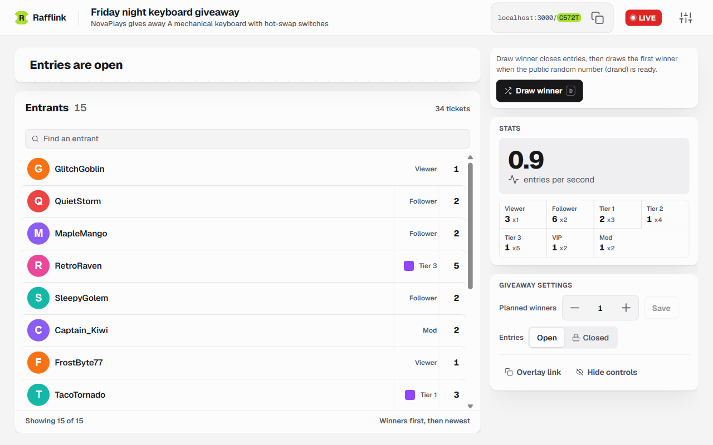
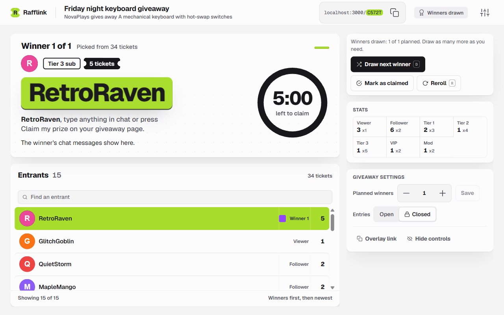
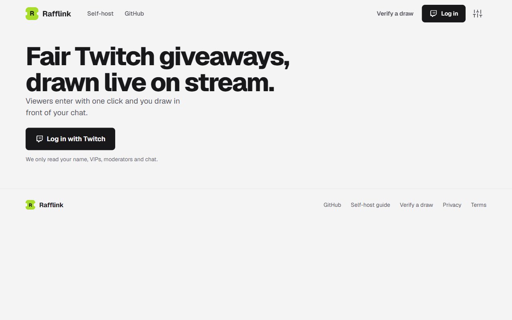
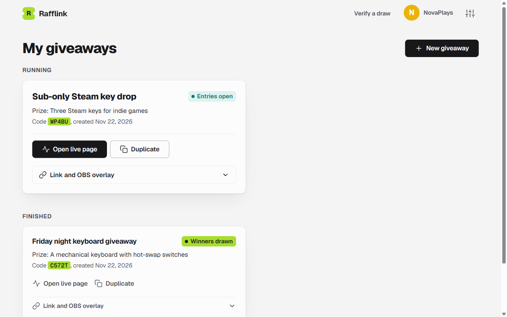
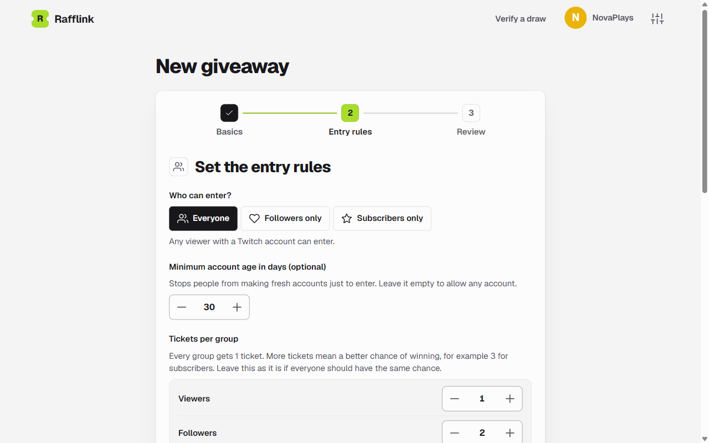
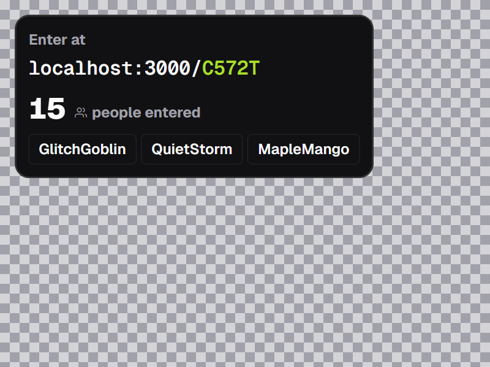
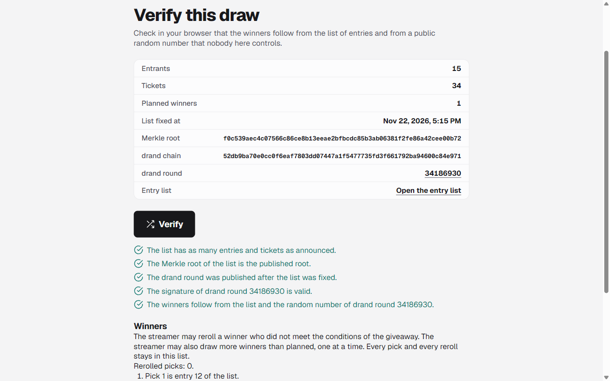
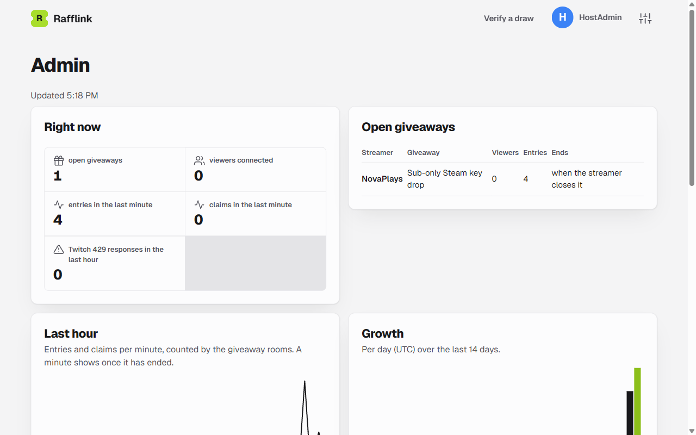
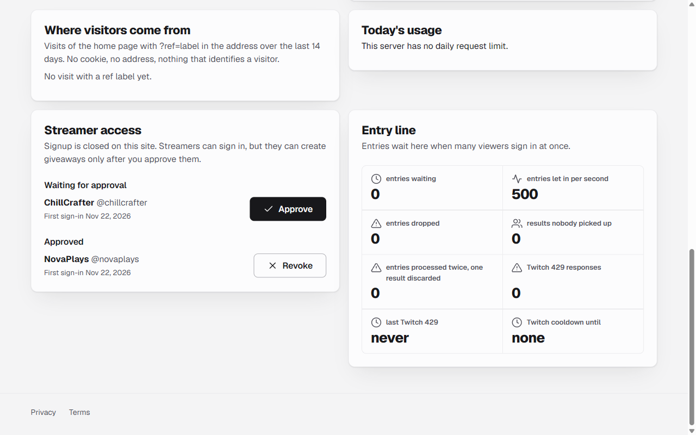

# Rafflink

Giveaways for Twitch streamers. The streamer creates a giveaway and posts a link; viewers open it, sign in
with Twitch and are entered, or type the giveaway's chat keyword when the streamer turned it on.

What it does:

- The streamer signs in with Twitch, creates a giveaway (title and prize are optional, ticket counts per
  group, optional filters and end time) and gets a short link such as `/K7M2P`.
- Viewers open the link, sign in with Twitch and are entered with the tickets of their best group
  (viewer, follower, subscriber tier, VIP, moderator). The streamer cannot enter their own giveaway.
- With a chat keyword (such as `!enter`) viewers can also enter by typing it in the stream chat. The same
  rules and ticket groups apply, the giveaway can take chat entries only, and the giveaway page answers "Am I in?"
  for the login of a chat entrant.
- The streamer watches a live page (also available as a read-only OBS overlay link), closes the giveaway
  and draws winners. Winners claim with a button or by writing in chat. A winner who does not claim can be
  rerolled.
- A streamer can turn on a public history page, `/s/twitch/<login>`, that lists their finished giveaways
  (title, prize, close date, entrant and winner counts, a link to each verify page) without naming anyone, and
  hide single giveaways from it.

## Screenshots

Taken from a self-hosted install running against the fake Twitch, with made-up streamers and viewers.



The streamer's live page while entries are open: entrants with their group and tickets, entry stats and the
draw controls.



The winner is drawn from a public drand random number and has a set time to claim, by button or in chat.

<table>
  <tr>
    <td width="50%"><br>Home page of a self-hosted install.</td>
    <td width="50%"><br>Dashboard with running and finished giveaways.</td>
  </tr>
  <tr>
    <td><br>Create wizard, entry rules step: who can enter and tickets per group.</td>
    <td><br>OBS overlay, shown here on a checkered background because it is transparent.</td>
  </tr>
  <tr>
    <td><br>Anyone can verify a draw in the browser.</td>
    <td><br>Admin page with live platform stats.</td>
  </tr>
  <tr>
    <td><br>The admin approves streamers when signup is closed.</td>
    <td></td>
  </tr>
</table>

## Running your own copy

Rafflink runs on Cloudflare (Workers, Durable Objects, D1) or on any server with Docker. Both targets share one
core and pass the same contract tests. Either way you register your own Twitch app and set a few secrets before the
first deploy. [docs/self-hosting.md](docs/self-hosting.md) has the full setup.

## Development

Requires [Bun](https://bun.sh) 1.4.5 or newer.

```sh
bun install
bun run check
bun run --filter @rafflink/server dev
```

The last command starts a server on <http://localhost:3000> with a fake Twitch, Kick and YouTube, so you need no
real app to try it. [CONTRIBUTING.md](CONTRIBUTING.md) has the details and the guidelines for UI copy.

## License

[AGPL-3.0](LICENSE)
